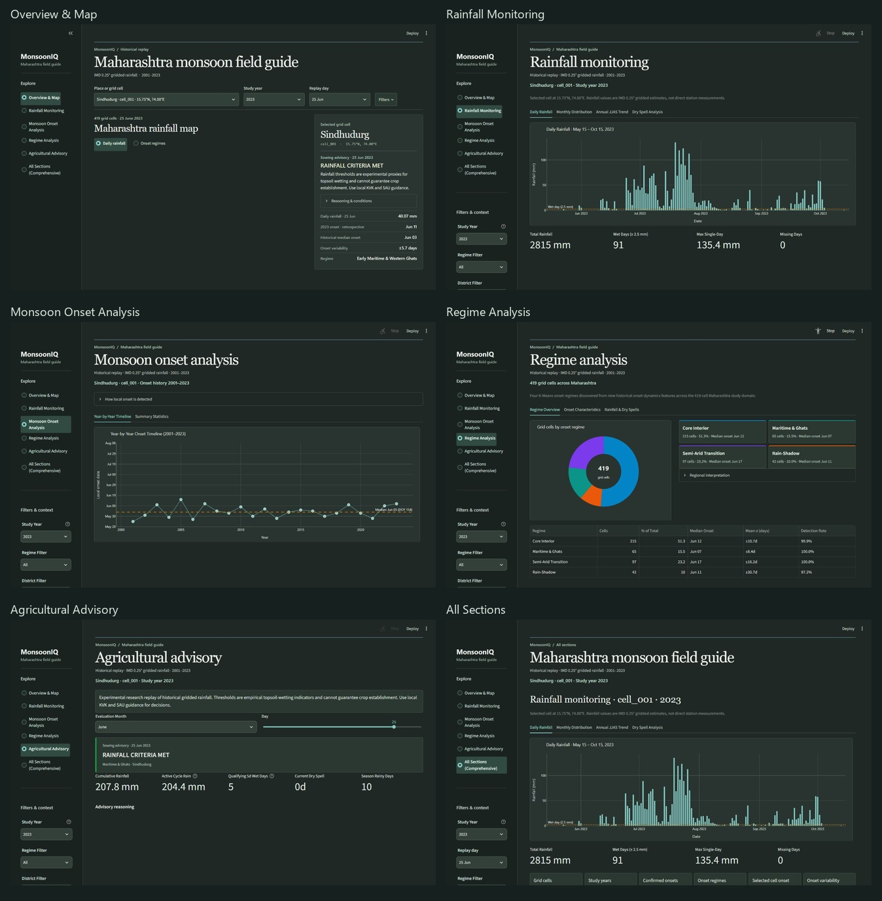
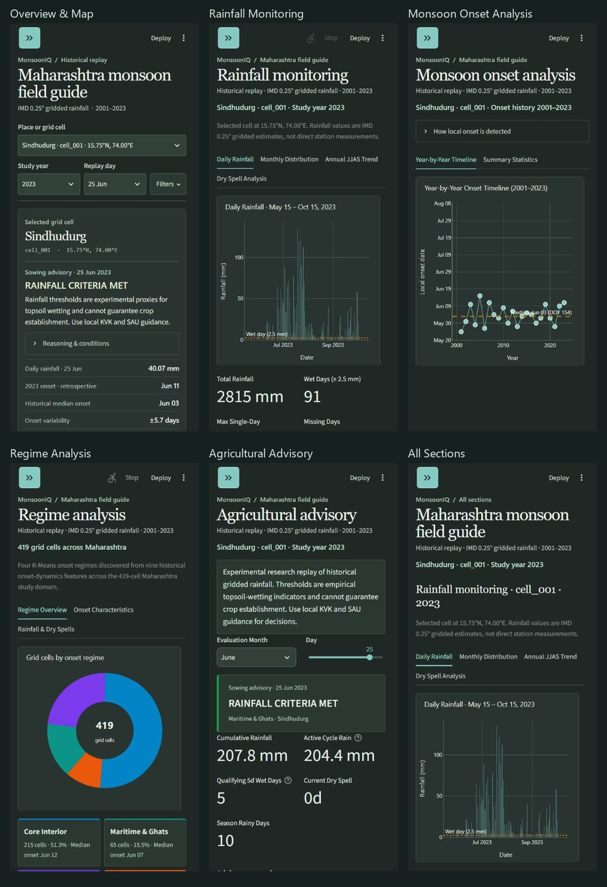

# MonsoonIQ: Hyperlocal Monsoon Onset Pattern Discovery & Agricultural Advisory Platform

[](https://www.python.org/)
[](https://opensource.org/licenses/MIT)
[](https://streamlit.io/)
[](https://www.imdpune.gov.in/)

**MonsoonIQ** is a Maharashtra-focused meteorological intelligence and agricultural risk research platform. By integrating 23 years (2001–2023) of high-resolution India Meteorological Department (IMD) 0.25° gridded daily rainfall data across 419 land cells, MonsoonIQ discovers recurring spatio-temporal monsoon onset regimes and drives a transparent, regime-aware sowing advisory engine.

The dashboard runs in **historical rainfall replay**. Choose a grid cell and an archived date to see historical rainfall and the advisory the research rules produce using observations through that date. Simulated data is reserved for testing. Live weather stations and forecast feeds are disconnected.

---

## 🌧️ Key Scientific Capabilities

1. **Hyperlocal Sustained Onset Detection (Phase 5B):**
   - 5-day accumulation threshold + 20-day verification window to distinguish true sustained onset from false starts.
   - Identified 9,606 confirmed onset events across 419 grid cells over 23 years.

2. **Unsupervised Onset Regime Discovery (Phases 6A–6B):**
   - Discovered 4 distinct agro-climatic monsoon onset regimes via K-Means clustering across 9 onset-dynamics features:
     - **Core Interior Synchronized (215 cells / 51.3%):** Vidarbha & eastern Marathwada; reliable Bay of Bengal surge (~June 12–14).
     - **Interior Semi-Arid Transition (97 cells / 23.2%):** Central transition belt with intermediate onset delay.
     - **Early Maritime & Western Ghats (65 cells / 15.5%):** Earliest onset (~June 7–9), heavy orographic precipitation.
     - **Rain-Shadow High-Volatility (42 cells / 10.0%):** Western Ghats lee (Ahmednagar, Solapur, Sangli, eastern Pune); high break frequency.

3. **Regime-Aware Sowing Advisory Engine (Phases 8.1–8.2):**
   - Transparent state machine (`RAINFALL_CRITERIA_MET`, `CAUTION`, `HIGH_RISK`, `INSUFFICIENT_DATA`).
   - Rain-Shadow Two-Stage verification: 75 mm active wetting cycle + two qualifying wet days (≥2.5 mm) within a 5-day window.
   - 10-day dry-spell moisture depletion reset prevents counting ancient evaporated rainfall.
   - Strictly prohibits misleading "Safe to Sow" declarations.

4. **Interactive Meteorological Dashboard (Phase 9):**
   - Dark field guide interface built with Streamlit and Plotly for desktop and mobile.
   - Interactive 419-cell Maharashtra map with daily rainfall and onset regime layers, hover details, and cell selection.
   - Daily rainfall timeseries, annual trends, monthly distributions, and dry spell monitoring.

---

## Run the dashboard locally

1. Open a terminal in the project folder that contains this README. With Python 3.12 installed, create a virtual environment.

   ```bash
   python -m venv .venv
   ```

   On Windows PowerShell, activate it with `.\.venv\Scripts\Activate.ps1`. On macOS or Linux, use `source .venv/bin/activate`.

2. Install the dashboard dependencies.

   ```bash
   python -m pip install streamlit==1.67.0 plotly numpy pandas xarray netCDF4 shapely
   ```

3. Place these processed files in `data/processed/`. This folder is Git-ignored, so a fresh checkout needs a copy of the project’s processed datasets. The map boundaries are in [`data/geo/`](data/geo/).

   - `maharashtra_imd_daily_2001_2023.nc`
   - `maharashtra_onset_2001_2023.nc`
   - `advisory_historical_baselines.csv`

4. Start Streamlit from the project root, then open [http://localhost:8501](http://localhost:8501).

   ```bash
   python -m streamlit run dashboard/app.py
   ```

---

## Dashboard pages

| Page | What you can explore |
| --- | --- |
| **Overview & Map** | Select a grid cell, study year, and replay day. Switch between daily rainfall and onset regimes, then inspect the cell’s rainfall, onset history, and dated advisory. |
| **Rainfall Monitoring** | Daily rainfall from May 15 to October 15, monthly distribution, June–September (JJAS) totals across 2001–2023, and dry spell duration. |
| **Monsoon Onset Analysis** | Year-by-year confirmed onset, the historical median, detection rates, and rejected candidates for the selected cell. |
| **Regime Analysis** | Compare the four onset regimes by cell count, onset timing and variability, June rainfall, and post-onset dry spells. |
| **Agricultural Advisory** | Evaluate a historical date and inspect the result, cumulative and active-cycle rainfall, rule checks, and contingency guidance. Rainfall thresholds are research indicators and cannot guarantee crop establishment. |
| **All Sections (Comprehensive)** | Browse the rainfall charts, interactive map, onset analysis, regime comparisons, and advisory on one page. |

### Desktop



### Mobile



[Download all 12 full-resolution screenshots](figures/dashboard-review/final/screenshots.zip).

---


## 🧪 Running the Test Suite

MonsoonIQ features an extensive, automated test suite covering data preprocessing, onset detection, clustering robustness, sowing trigger consistency, advisory engine rules, and dashboard integration.

Run all 182 unit and integration tests:

```bash
uv run pytest -v
```

Run dashboard-specific tests:
```bash
uv run pytest tests/test_dashboard.py -v
```

---

## 📁 Repository Structure

```
MonsoonIQ/
├── dashboard/                     # Streamlit Interactive Dashboard
│   ├── app.py                     # Main application entry point & dark theme
│   ├── components/                # Modular UI components
│   │   ├── header.py              # Title & metadata header
│   │   ├── metric_cards.py        # Top summary metric cards
│   │   ├── rainfall_atlas.py      # Interactive rainfall and regime map
│   │   ├── rainfall_charts.py     # Plotly daily, monthly, and annual charts
│   │   ├── onset_analysis.py      # Onset timeline and statistics
│   │   ├── regime_analysis.py     # 4-regime comparative analysis
│   │   ├── advisory_panel.py      # Sowing advisory engine interface
│   │   └── provenance.py          # Provenance banners & scientific caveats
│   ├── services/                  # Cached data loaders and aggregation services
│   │   ├── data_loader.py         # NetCDF and CSV cached loaders
│   │   └── dashboard_service.py   # Higher-level summary computation
│   └── utils/                     # Formatting and constants
│       ├── constants.py           # Colors, paths, regimes, and study period
│       └── formatting.py          # Date, DOY, and unit formatters
├── src/                           # Backend Core Package
│   └── advisory/                  # Advisory state machine, models, and rules
│       ├── decision_engine.py     # Core advisory decision engine
│       ├── rainfall_monitor.py    # Rainfall accumulation & dry-spell tracker
│       ├── lookup_service.py      # Grid cell and regime lookup
│       └── models.py              # Pydantic/dataclass data structures
├── data/
│   ├── processed/                 # Processed NetCDF and CSV datasets (Git-ignored)
│   └── geo/                       # GeoJSON administrative boundaries
├── docs/                          # Detailed Phase 1–9 Scientific Reports
├── tests/                         # Comprehensive test suites (182 tests)
└── README.md                      # Project documentation and run guide
```

---

## 📄 IEEE Conference Research Paper

The complete academic research paper for MonsoonIQ is authored in official IEEE conference format:

- **LaTeX Source:** [`main.tex`](main.tex) (also preserved as [`MonsoonIQ_IEEE_Paper.tex`](MonsoonIQ_IEEE_Paper.tex))
- **BibTeX Bibliography:** [`references.bib`](references.bib)
- **High-Resolution Figures:** [`figures/`](figures/) (12 publication-quality scientific plots and system diagrams)
- **Compiled PDF:** [`main.pdf`](main.pdf) (also preserved as [`MonsoonIQ_IEEE_Paper.pdf`](MonsoonIQ_IEEE_Paper.pdf))
- **Data Verification Dossier:** [`DATA_VERIFICATION_REPORT.md`](DATA_VERIFICATION_REPORT.md)

### Overleaf Compilation Instructions
1. In Overleaf, click **New Project** $\rightarrow$ **Blank Project** (or upload ZIP).
2. Upload `main.tex`, `references.bib`, and the `figures/` folder.
3. Ensure the compiler is set to **pdfLaTeX** with TeX Live 2023 or newer.
4. Click **Recompile** to generate the two-column IEEE conference paper.

### Local Compilation Instructions
```bash
# Standard LaTeX toolchain:
pdflatex main.tex
bibtex main
pdflatex main.tex
pdflatex main.tex

# Or instant local build via Typst:
uv run python -c "import typst; typst.compile('MonsoonIQ_IEEE_Paper.typ', output='main.pdf')"
```

---

## 🔬 Scientific Data Integrity & Boundaries

- **Spatial Resolution:** Values are spatial averages over 0.25° × 0.25° (~27 km × 27 km) grid boxes produced by IMD's gridded interpolation. They do not represent point rain-gauge measurements.
- **Missing Data Handling:** Missing values are strictly preserved as `NaN` and are never imputed as zero.
- **Agricultural Caveat:** Rainfall thresholds are empirical topsoil moisture proxies, not guarantees of crop emergence or yield. Never use "Safe to Sow".
