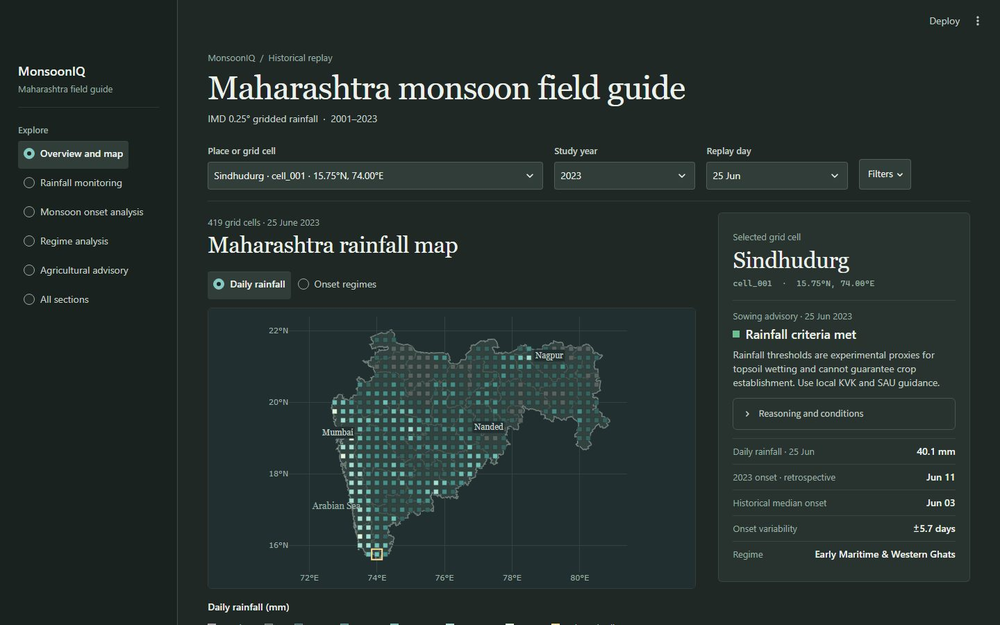
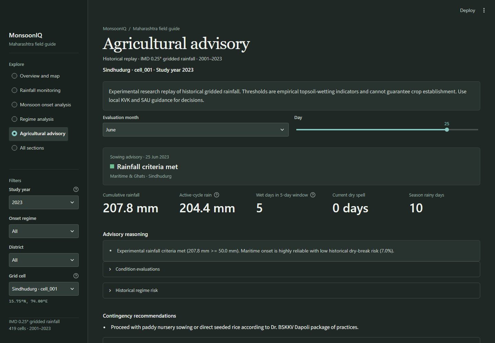
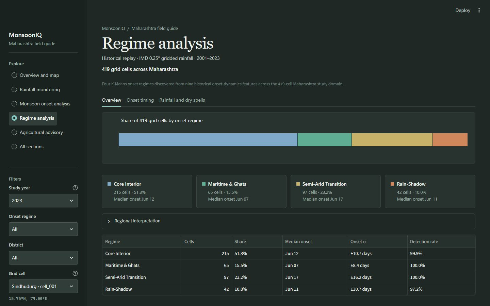
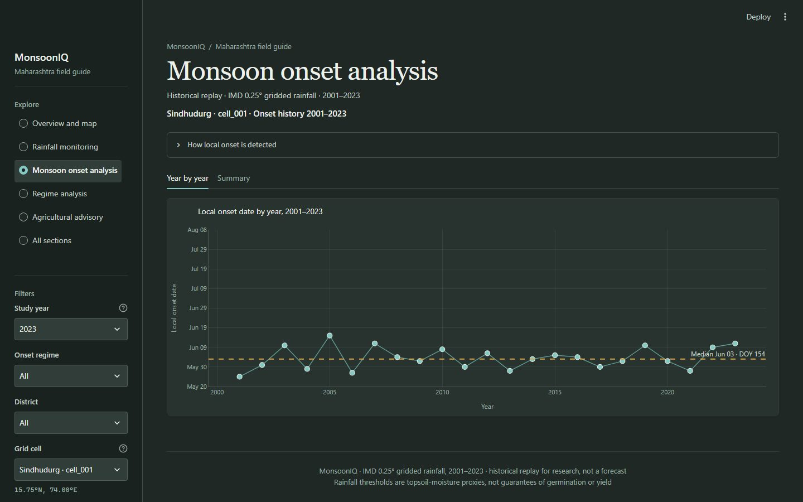
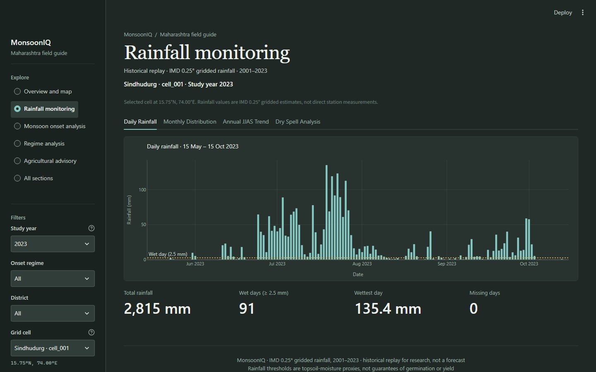
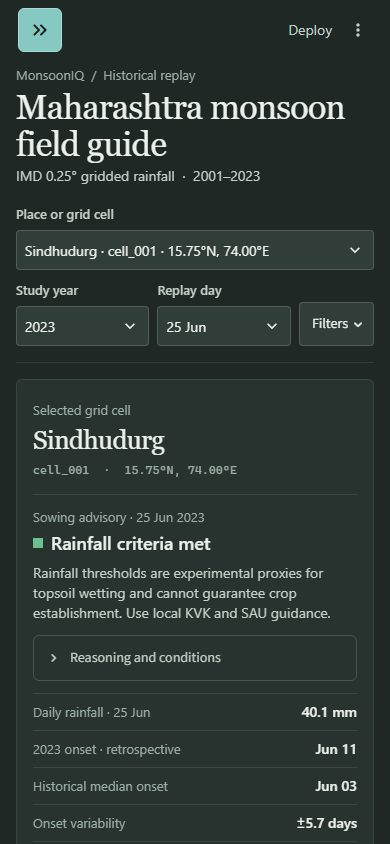

<div align="center">

# MonsoonIQ

**Hyperlocal Monsoon Onset and Sowing Advisory Dashboard for Maharashtra**

A research platform that detects local monsoon onset from 23 years of IMD gridded rainfall, groups Maharashtra into four onset regimes, and shows a rule-based, regime-aware sowing advisory in a Streamlit dashboard.

[](https://moonsooniq.streamlit.app/)
[](requirements.txt)
[](requirements.txt)
[](requirements.txt)
[](requirements.txt)
[](tests/)
[](https://www.imdpune.gov.in/)

[Live application](https://moonsooniq.streamlit.app/) · [Research paper](MonsoonIQ_IEEE_Paper.pdf) · [Phase reports](docs/) · [GitHub repository](https://github.com/Ashwell-CG/MoonsoonIQ)

</div>

> **Important:** MonsoonIQ replays **historical** rainfall (2001–2023). It is not a weather forecast and does not use live observations. Advisory states are research indicators of topsoil wetting. They cannot guarantee crop establishment or yield, and the dashboard never declares a field "safe to sow". Use local KVK and state agricultural university guidance for decisions.



## Contents

1. [Live demo](#live-demo)
2. [Overview](#overview)
3. [Key features](#key-features)
4. [Screenshots](#screenshots)
5. [System architecture](#system-architecture)
6. [Methodology](#methodology)
7. [Dataset](#dataset)
8. [Results](#results)
9. [Validation status](#validation-status)
10. [Technology stack](#technology-stack)
11. [Project structure](#project-structure)
12. [Local installation](#local-installation)
13. [Testing](#testing)
14. [Deployment](#deployment)
15. [Limitations](#limitations)
16. [Future improvements](#future-improvements)
17. [Academic documentation](#academic-documentation)

## Live demo

| Resource | URL |
|---|---|
| Dashboard | https://moonsooniq.streamlit.app/ |
| Overview and map | https://moonsooniq.streamlit.app/?section=Overview%20%26%20Map |
| Agricultural advisory | https://moonsooniq.streamlit.app/?section=Agricultural%20Advisory |

The app runs on Streamlit Community Cloud's free plan. After a period of inactivity the first visit can take 30 seconds or more while the app wakes up and loads the 15 MB rainfall file.

## Overview

The monsoon does not arrive on one date. Across Maharashtra the first sustained rains differ by place and by year, and an early shower can be followed by a long dry break that kills a freshly sown crop. A single state-wide onset date hides this.

MonsoonIQ works at the scale of one IMD grid cell (0.25° × 0.25°, about 27 km):

1. It detects a **local sustained onset** for each of 419 land cells in each of 23 years, using a 5-day accumulation test and a 20-day verification window to reject false starts.
2. It groups the cells into **four onset regimes** with K-Means on nine onset-dynamics features.
3. It runs a **rule-based advisory engine** that, for a chosen cell and date, looks only at rainfall up to that date and reports one of four states with the rules, thresholds and sources behind it.
4. It presents all of this in a **Streamlit dashboard** built around a replay: pick a place, a year and a day in June or July, and see what the rules would have said.

The project is an academic study and a deployed application. It does not fetch live weather.

## Key features

- **Local onset detection** across 419 cells and 23 seasons, with 9,606 confirmed onsets out of 9,637 cell-years.
- **Four discovered regimes** with named, mappable agro-climatic meaning (see [Results](#results)).
- **Regime-aware sowing advisory** with four explicit states: `RAINFALL CRITERIA MET`, `CAUTION`, `HIGH RISK` and `INSUFFICIENT DATA`.
- **Transparent reasoning**: every advisory lists the conditions it checked, the threshold, the actual value and the source of the rule.
- **Active-wetting-cycle reset**: a dry spell of 10 days or more discards earlier rainfall as evaporated.
- **Interactive atlas** of all 419 cells, switchable between daily rainfall and onset regime, with a selected-cell marker.
- **Rainfall monitoring**: daily rainfall, monthly distribution, June–September totals by year and dry-spell analysis.
- **Data provenance**: the interface states that the data is a historical replay and lists which sources are connected and which are not.
- **Responsive dark interface** that works on desktop and phone widths.

## Screenshots

| Overview and map | Agricultural advisory |
|---|---|
|  |  |

| Regime analysis | Monsoon onset analysis |
|---|---|
|  |  |

| Rainfall monitoring | Mobile |
|---|---|
|  |  |

## System architecture

```mermaid
flowchart LR
    I[("IMD Pune<br/>0.25° daily rainfall<br/>2001–2023")] --> P["Preprocessing<br/>scripts/preprocess_imd_history.py"]
    P --> N[("Processed NetCDF<br/>data/processed")]
    N --> O["Onset detection<br/>5-day accumulation +<br/>20-day verification"]
    O --> F["Nine onset-dynamics<br/>features per cell"]
    F --> K["K-Means, K = 4<br/>onset regimes"]
    K --> B[("Baselines CSV<br/>regime + history per cell")]

    N --> L["dashboard/services<br/>cached loaders"]
    B --> L
    L --> A["src/advisory<br/>RainfallMonitor +<br/>AdvisoryDecisionEngine"]
    L --> C["dashboard/components<br/>map, charts, panels"]
    A --> C
    C --> S(["Streamlit app<br/>Community Cloud"])
```



| Layer | Location | Role |
|---|---|---|
| Data pipeline | `scripts/`, `data/processed/` | Acquire, preprocess, detect onset, build features, cluster, audit |
| Advisory engine | `src/advisory/` | Rainfall accumulation, dry-spell tracking, regime lookup, decision rules |
| Services | `dashboard/services/` | Cached NetCDF and CSV loaders, summary computation |
| Interface | `dashboard/components/`, `dashboard/app.py` | Pages, atlas, charts, advisory panel, styling |

The dashboard reads processed files from `data/processed/` and `data/geo/` only. It never calls an external API.

## Methodology

### Local sustained onset

A candidate onset is the first day on which rainfall reaches the accumulation threshold within a 5-day window. It is **confirmed** only if the following 20-day verification window passes, which separates a true onset from a false start. This is a rainfall-based local definition, not the synoptic regional onset declared by IMD. Details: [`docs/PHASE_5A_ONSET_METHODOLOGY.md`](docs/PHASE_5A_ONSET_METHODOLOGY.md) and [`docs/PHASE_5B_ONSET_RESULTS.md`](docs/PHASE_5B_ONSET_RESULTS.md).

### Regime discovery

Each cell is described by nine features covering onset timing, variability, early and delayed onset frequency, rejected candidates, dry-spell length and detection rate. K-Means with K = 4 was chosen and then stress-tested against hierarchical clustering, bootstrap resampling and feature-ablation checks. Details: [`docs/PHASE_6_CLUSTERING_RESULTS.md`](docs/PHASE_6_CLUSTERING_RESULTS.md) and [`docs/PHASE_6B_CLUSTERING_VALIDATION.md`](docs/PHASE_6B_CLUSTERING_VALIDATION.md).

### Sowing advisory

The advisory engine is a small state machine over rainfall observed up to the chosen date. A wet day is a day with at least 2.5 mm. The rules include:

- A data-completeness check: at least 90% complete and at most 3 missing days.
- A cumulative rainfall threshold, 50 mm by default.
- **Rain-Shadow regime, two-stage rule**: 75 mm in the active wetting cycle, and two qualifying wet days within a 5-day verification window.
- A **10-day dry-break reset**: earlier rainfall is not counted after a dry spell of 10 days or more.
- A heavy-rainfall hazard check for single-day and three-day totals.

The Rain-Shadow rule exists because a plain 50 mm trigger there is followed by a dry spell of 10 days or more in 39.13% of triggered years (see [Results](#results)). Details: [`docs/PHASE_7_1_SOWING_TRIGGER_AUDIT.md`](docs/PHASE_7_1_SOWING_TRIGGER_AUDIT.md), [`docs/PHASE_8_ADVISORY_ENGINE.md`](docs/PHASE_8_ADVISORY_ENGINE.md) and [`docs/PHASE_8_2_ACCUMULATION_AUDIT.md`](docs/PHASE_8_2_ACCUMULATION_AUDIT.md).

## Dataset

| Item | Detail |
|---|---|
| Source | India Meteorological Department, Pune: gridded daily rainfall, Climate Monitoring and Prediction Group |
| Resolution | 0.25° × 0.25° (about 27 km × 27 km) |
| Period | 2001–2023 (23 monsoon seasons) |
| Domain | Maharashtra: 419 valid land cells |
| Cross-check | CHIRPS 2023 was audited as an independent comparison ([`docs/PHASE_1B_SCIENTIFIC_AUDIT.md`](docs/PHASE_1B_SCIENTIFIC_AUDIT.md)) |

What the data is, and is not:

- Values are **spatial averages over grid boxes**, not rain-gauge readings at a village.
- Missing values are kept as missing. They are never filled with zero.
- The repository includes the processed files the dashboard needs: two NetCDF files and three CSV files in `data/processed/`, and the boundaries in `data/geo/`. Raw downloads and intermediate files are not included.

Acquisition and preprocessing are described in [`docs/PHASE_2_IMD_ACQUISITION.md`](docs/PHASE_2_IMD_ACQUISITION.md) and [`docs/PHASE_3_DATA_PREPROCESSING.md`](docs/PHASE_3_DATA_PREPROCESSING.md).

## Results

### The four regimes

| Regime | Cells | Share | Median onset | Onset spread (σ) | Detection rate |
|---|---:|---:|---|---:|---:|
| Core Interior Synchronized | 215 | 51.3% | 12 Jun | ±10.7 days | 99.9% |
| Interior Semi-Arid Transition | 97 | 23.2% | 17 Jun | ±16.2 days | 100.0% |
| Early Maritime & Western Ghats | 65 | 15.5% | 7 Jun | ±8.4 days | 100.0% |
| Rain-Shadow High-Volatility | 42 | 10.0% | 11 Jun | ±30.7 days | 97.2% |

Median onset and spread are regime means of the per-cell values shown on the dashboard's Regime analysis page.

### Why the Rain-Shadow regime has its own rule

After the first 50 mm of rain, the chance of a dry spell within the next 20 days is:

| Regime | Dry spell ≥ 7 days | Dry spell ≥ 10 days |
|---|---:|---:|
| Core Interior Synchronized | 35.61% | 12.52% |
| Rain-Shadow High-Volatility | **65.59%** | **39.13%** |
| Early Maritime & Western Ghats | 18.83% | 7.04% |
| Interior Semi-Arid Transition | 48.64% | 24.99% |

Source: [`docs/PHASE_7_1_SOWING_TRIGGER_AUDIT.md`](docs/PHASE_7_1_SOWING_TRIGGER_AUDIT.md).

### Clustering quality

| Check | Result |
|---|---|
| K-Means K = 4, silhouette | 0.2987 |
| K-Means K = 4, Davies-Bouldin / Calinski-Harabasz | 1.1948 / 189.71 |
| Seed stability, 10 random seeds (ARI) | 0.9942 |
| Agreement with Ward hierarchical clustering (ARI) | 0.680 |
| Bootstrap over the 23 years, 100 resamples (mean ARI) | 0.4028, 95% interval 0.2299 to 0.6119 |

How to read these: K = 2 and K = 3 score a higher silhouette (0.353 and 0.348) because they split the state into broad halves. K = 4 was kept because it separates the interior from the volatile rain-shadow cells, which matters for sowing. The cluster structure is **moderately stable** when years are resampled, so regime boundaries should be read as indicative and not as sharp lines. Source: [`docs/PHASE_6_CLUSTERING_RESULTS.md`](docs/PHASE_6_CLUSTERING_RESULTS.md) and [`docs/PHASE_6B_CLUSTERING_VALIDATION.md`](docs/PHASE_6B_CLUSTERING_VALIDATION.md).

## Validation status

| Item | Status |
|---|---|
| Automated tests (`tests/`) | 183 passed |
| Advisory rules audited against agronomy sources | Documented in `docs/PHASE_8_1_ADVISORY_LOGIC_AUDIT.md` |
| Dashboard checked in a browser at 360, 390, 768, 1024 and 1440 px | No horizontal overflow and no error boxes on all six pages (manual check, not automated in the repository) |
| Fresh-clone start-up | Verified: a clean clone runs the app without extra files |
| Comparison of advisories with real farm outcomes | **Not done** |
| Comparison with live station observations | **Not done** (no live feed is connected) |

The advisory states describe what a rainfall rule says about historical data. They have not been validated against sowing results in farmers' fields.

## Technology stack

| Area | Technologies |
|---|---|
| Interface | Streamlit 1.67, Plotly 7.1, custom CSS |
| Data handling | xarray, netCDF4, pandas 3.1, NumPy 2.5, SciPy, Shapely |
| Advisory engine | Plain Python dataclasses and a rule-based state machine in `src/advisory/` |
| Analysis scripts | scikit-learn (K-Means, hierarchical clustering, metrics), matplotlib |
| Deployment | Streamlit Community Cloud |
| Testing | pytest |
| Paper | IEEE conference format, LaTeX and Typst sources |

## Project structure

```text
MonsoonIQ/
├── dashboard/
│   ├── app.py                   Streamlit entry point: navigation, filters, page routing
│   ├── components/              Pages and widgets
│   │   ├── field_guide.py       Overview page: place picker, atlas, advisory record
│   │   ├── rainfall_atlas.py    Tile-free Maharashtra map of 419 cells
│   │   ├── rainfall_charts.py   Daily, monthly, seasonal and dry-spell charts
│   │   ├── onset_analysis.py    Year-by-year onset and summary statistics
│   │   ├── regime_analysis.py   Four-regime comparison
│   │   ├── advisory_panel.py    Advisory state, reasoning and conditions
│   │   ├── provenance.py        Data-source notes and scientific caveats
│   │   └── *.css                Field-guide and analysis-page styles
│   ├── services/                Cached loaders and aggregation
│   └── utils/                   Constants, formatting, chart theme
├── src/advisory/                Advisory engine: models, rainfall monitor, regime lookup, decisions
├── scripts/                     Acquisition, preprocessing, onset, clustering and audit scripts
├── data/
│   ├── processed/               NetCDF and CSV files read by the dashboard
│   └── geo/                     Maharashtra state and district boundaries (GeoJSON)
├── docs/                        Phase 1–9 reports; docs/images/ holds README screenshots
├── figures/                     Figures used in the paper
├── tests/                       Test suites
├── .streamlit/config.toml       Theme and server settings
├── requirements.txt             Runtime dependencies for the deployed app
└── README.md
```

## Local installation

These steps are for Windows PowerShell. You need Python 3.12.

**1. Clone the repository**

```powershell
git clone https://github.com/Ashwell-CG/MoonsoonIQ.git
cd MoonsoonIQ
```

**2. Create a virtual environment and install the requirements**

```powershell
python -m venv .venv
.\.venv\Scripts\Activate.ps1
python -m pip install -r requirements.txt
```

**3. Start the dashboard**

```powershell
python -m streamlit run dashboard/app.py
```

Open `http://localhost:8501`. The processed data files are already in the repository, so nothing else is needed.

On macOS or Linux, activate with `source .venv/bin/activate` instead.

## Testing

| Suite | Command (from the project root) | Result |
|---|---|---|
| Full test suite | `python -m pytest -q` | 183 passed |
| Dashboard tests only | `python -m pytest tests/test_dashboard.py -q` | Included in the total |

The runtime `requirements.txt` is enough to start the app. The full test suite also uses scikit-learn, matplotlib and pytest, so install them first:

```powershell
python -m pip install pytest scikit-learn matplotlib
```

The tests cover preprocessing, onset detection, clustering, the sowing-trigger audits, the advisory engine and the dashboard helpers.

## Deployment

The app is deployed on Streamlit Community Cloud.

| Setting | Value |
|---|---|
| Repository | `Ashwell-CG/MoonsoonIQ`, branch `main` |
| Main file path | `dashboard/app.py` |
| Python version | 3.12 |
| Dependencies | `requirements.txt` |
| Secrets | None required |

The repository includes the processed data files (about 15 MB for the daily rainfall NetCDF), because the deployed app reads them at start-up. The raw and intermediate data folders are git-ignored.

To deploy your own copy: push the repository to GitHub, open share.streamlit.io, choose **Create app**, select the repository and branch, set the main file to `dashboard/app.py`, pick Python 3.12 under advanced settings, and deploy.

## Limitations

- **Historical replay only**: there is no live station feed and no forecast model. The interface lists these sources as not connected.
- **Gridded data**: 0.25° averages cannot represent a single field or village. Local rainfall can differ.
- **Rainfall-only rules**: the advisory looks at rainfall. It does not use soil type, soil moisture measurements, temperature, crop variety or irrigation.
- **Rule thresholds are proxies**: 50 mm and 75 mm are topsoil-wetting indicators from agronomy guidance, not guarantees of germination.
- **Local onset definition**: onset here is rainfall-based and local. It differs from the official regional onset declared by IMD.
- **Moderate cluster stability**: regimes are stable across random seeds but only moderately stable when years are resampled (mean ARI 0.40).
- **Short record**: 23 seasons cannot capture long-term climate shifts.
- **No field validation**: advisories have not been compared with real sowing outcomes.
- **Free hosting**: the app sleeps when idle and the first request is slow.
- **No licence file yet**: the repository does not currently state a licence.

## Future improvements

These are proposals, not features of the current version.

- Connect observed station data (for example AWS networks) and label it clearly as observed.
- Evaluate advisories against recorded sowing and crop-establishment outcomes.
- Add soil-moisture or soil-type information to the rules.
- Test the regimes on a longer record and on rolling time windows.
- Add a forecast-driven mode only after it can be validated and clearly separated from the replay.
- Add a licence and a data-use statement for the processed files.

## Academic documentation

| Document | Link |
|---|---|
| IEEE conference paper (PDF) | [`MonsoonIQ_IEEE_Paper.pdf`](MonsoonIQ_IEEE_Paper.pdf) |
| Paper source and bibliography | [`main.tex`](main.tex), [`references.bib`](references.bib) |
| Data verification dossier | [`DATA_VERIFICATION_REPORT.md`](DATA_VERIFICATION_REPORT.md) |
| Phase 1B: CHIRPS audit | [`docs/PHASE_1B_SCIENTIFIC_AUDIT.md`](docs/PHASE_1B_SCIENTIFIC_AUDIT.md) |
| Phase 2: IMD acquisition | [`docs/PHASE_2_IMD_ACQUISITION.md`](docs/PHASE_2_IMD_ACQUISITION.md) |
| Phase 3: Preprocessing | [`docs/PHASE_3_DATA_PREPROCESSING.md`](docs/PHASE_3_DATA_PREPROCESSING.md) |
| Phase 4: Exploratory analysis | [`docs/PHASE_4_EDA_REPORT.md`](docs/PHASE_4_EDA_REPORT.md) |
| Phase 5A: Onset methodology | [`docs/PHASE_5A_ONSET_METHODOLOGY.md`](docs/PHASE_5A_ONSET_METHODOLOGY.md) |
| Phase 5B: Onset results | [`docs/PHASE_5B_ONSET_RESULTS.md`](docs/PHASE_5B_ONSET_RESULTS.md) |
| Phase 6: Clustering results | [`docs/PHASE_6_CLUSTERING_RESULTS.md`](docs/PHASE_6_CLUSTERING_RESULTS.md) |
| Phase 6B: Clustering validation | [`docs/PHASE_6B_CLUSTERING_VALIDATION.md`](docs/PHASE_6B_CLUSTERING_VALIDATION.md) |
| Phase 7: Regime agricultural validation | [`docs/PHASE_7_REGIME_AGRICULTURAL_VALIDATION.md`](docs/PHASE_7_REGIME_AGRICULTURAL_VALIDATION.md) |
| Phase 7.1: Sowing trigger audit | [`docs/PHASE_7_1_SOWING_TRIGGER_AUDIT.md`](docs/PHASE_7_1_SOWING_TRIGGER_AUDIT.md) |
| Phase 8: Advisory engine | [`docs/PHASE_8_ADVISORY_ENGINE.md`](docs/PHASE_8_ADVISORY_ENGINE.md) |
| Phase 8.1: Advisory logic audit | [`docs/PHASE_8_1_ADVISORY_LOGIC_AUDIT.md`](docs/PHASE_8_1_ADVISORY_LOGIC_AUDIT.md) |
| Phase 8.2: Accumulation audit | [`docs/PHASE_8_2_ACCUMULATION_AUDIT.md`](docs/PHASE_8_2_ACCUMULATION_AUDIT.md) |
| Phase 9: Dashboard report | [`docs/PHASE_9_DASHBOARD_REPORT.md`](docs/PHASE_9_DASHBOARD_REPORT.md) |
