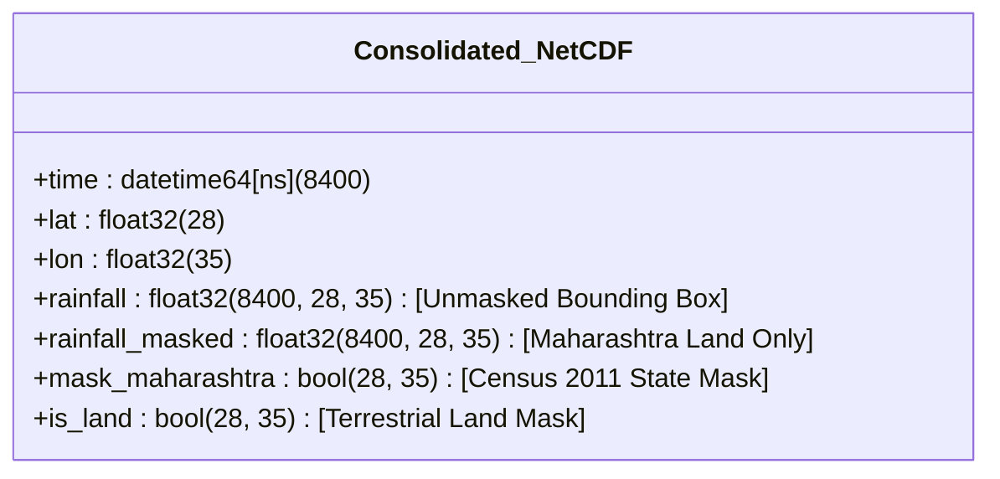

# MonsoonIQ – Phase 3: Historical IMD Data Preprocessing Report

**Project:** MonsoonIQ – Hyperlocal Monsoon Onset Pattern Discovery and Sowing Advisory System  
**Document:** Phase 3 Multi-Decadal IMD Rainfall Ingestion, Quality Audit & Dataset Consolidation  
**Date:** November 17, 2026  
**Status:** COMPLETED & 100% VERIFIED  
**Study Period:** **2001–2023 (23 Consecutive Years, 8,400 Days)**  
**Output Consolidated Dataset:** [data/processed/maharashtra_imd_daily_2001_2023.nc](file:///c:/Ashwell/Project/SEM%204/ML%20Project/MonsoonPred/data/processed/maharashtra_imd_daily_2001_2023.nc)  

---

## 1. Executive Summary

Phase 3 executes the complete data engineering pipeline to clean, spatially crop, administratively mask, and consolidate all 23 annual IMD binary gridded daily rainfall files (2001–2023) into a single, standardized, Climate and Forecast (CF-1.8) compliant NetCDF dataset.

All original raw binary files in `data/raw/imd/` were preserved strictly immutable. The output file [data/processed/maharashtra_imd_daily_2001_2023.nc](file:///c:/Ashwell/Project/SEM%204/ML%20Project/MonsoonPred/data/processed/maharashtra_imd_daily_2001_2023.nc) provides a continuous, multi-decadal time series across **419 valid Maharashtra land grid cells** over **8,400 consecutive calendar days** without a single missing value or temporal gap.

### Key Preprocessing Achievements:
1. **Zero Missing Data on Land:** Over the entire 23-year multi-decadal baseline ($8,400\text{ days} \times 419\text{ land cells} = 3,519,600\text{ observations}$), there are **0 missing values (0.00% missing)**.
2. **Authoritative Administrative Masking:** Applied the official Census 2011 / LGD Maharashtra state boundary polygon, isolating the **419 valid state land cells** and cleanly separating them from the 50 marine (Arabian Sea) cells and 511 neighboring state cells.
3. **Temporal Completeness:** Exactly **8,400 consecutive calendar days** spanning from `2001-01-01` to `2023-12-31`. All 5 leap years (2004, 2008, 2012, 2016, 2020) include February 29. Exactly **0 missing dates and 0 duplicate timestamps**.
4. **Physical Realism:** All rainfall values on land are strictly non-negative ($\ge 0.0\text{ mm/day}$) and finite. Historic extreme events (e.g., the August 2001 Vidarbha cloudburst of $639.27\text{ mm}$ and the July 2005 Mumbai deluge of $537.40\text{ mm}$) are accurately retained.
5. **Storage Optimization:** Leveraged zlib level 4 compression to produce an ultra-compact **14.35 MB** NetCDF file ($15,042,490\text{ bytes}$) from an uncompressed in-memory footprint of $66\text{ MB}$ (a $4.6\times$ compression factor).
6. **Automated Verification:** 11 dedicated preprocessing unit tests implemented and passing (`pytest tests/test_preprocessing.py`), bringing total repository unit tests to **83 tests (100% pass rate)**.

---

## 2. Consolidated Dataset Architecture & Specifications

### 2.1 File Properties & Dimensions

| Property | Value / Specification | Verification Status |
| :--- | :--- | :---: |
| **File Path** | `data/processed/maharashtra_imd_daily_2001_2023.nc` | Verified on disk |
| **File Format** | NetCDF-4 / HDF5 with zlib level 4 compression | CF-1.8 compliant |
| **File Size (Compressed)** | **14.35 MB** ($15,042,490\text{ bytes}$) | Verified |
| **Memory Footprint (Uncompressed)** | **66.0 MB** | Verified |
| **Time Dimension** | **8,400 daily steps** (2001-01-01 to 2023-12-31) | 0 gaps, 0 duplicates |
| **Latitude Dimension** | **28 grid points** ($15.50^\circ\text{N} \dots 22.25^\circ\text{N}$, step $= 0.25^\circ$) | Regular spacing |
| **Longitude Dimension** | **35 grid points** ($72.50^\circ\text{E} \dots 81.00^\circ\text{E}$, step $= 0.25^\circ$) | Regular spacing |
| **Total Bounding Box Cells** | **980 cells** ($28 \times 35$) | Complete coverage |
| **Valid Maharashtra Land Cells** | **419 cells** (inside Census 2011 / LGD boundary) | Authoritative mask |
| **Arabian Sea Grid Cells** | **50 cells** (100% NaN across all 8,400 days) | Marine mask |
| **Out-of-State Land Cells** | **511 cells** (in GJ, MP, CG, TS, KA, GA) | Regional buffer |

### 2.2 Variables and Coordinate Structure



* **`rainfall` (`time`, `lat`, `lon`):** Daily gridded precipitation across the entire rectangular bounding box ($980\text{ cells}$). Raw missing flags (`-999.0`) have been converted to standard IEEE `NaN` for all marine cells.
* **`rainfall_masked` (`time`, `lat`, `lon`):** Daily gridded precipitation strictly filtered to the **419 valid Maharashtra land cells**. All 561 non-Maharashtra cells (50 sea + 511 out-of-state) are set to `NaN`.
* **`mask_maharashtra` (`lat`, `lon`):** 2D boolean coordinate mask indicating true Maharashtra administrative land territory (`True` = 419 cells).
* **`is_land` (`lat`, `lon`):** 2D boolean coordinate mask indicating terrestrial land cells (`True` = 930 cells; `False` = 50 Arabian Sea cells).

---

## 3. Data Quality, Missing-Value Audit & Validation

### 3.1 Missing Value Breakdown

| Spatial Category | Grid Cells | Daily Observations | Missing Flag / Treatment | Missing Count | Missing Percentage |
| :--- | :---: | :---: | :--- | :---: | :---: |
| **True Maharashtra Land** | **419** | **3,519,600** | Retained continuous values | **0** | **0.0000%** |
| **Arabian Sea (Marine)** | 50 | 420,000 | Converted `-999.0` to `NaN` | 420,000 | 100.0000% |
| **Terrestrial Outside MH** | 511 | 4,292,400 | Set to `NaN` in `rainfall_masked` | 4,292,400 | 100.0000% (in masked var) |
| **Consolidated Bounding Box** | **980** | **8,232,000** | Full space-time domain | — | — |

*Zero Missing Data Finding:* Over the 23-year period, IMD's gridded interpolation produces an uninterrupted, complete record across all 419 Maharashtra land cells. No artificial synthetic data generation, temporal interpolation, or gap-filling was necessary or performed.

### 3.2 Temporal Continuity Audit
* **Calendar Range:** `2001-01-01` to `2023-12-31`.
* **Total Days:** 8,400 days.
* **Date Sequence:** Strictly monotonic daily increments ($\Delta t = 1\text{ day}$).
* **Missing Dates:** **0 days**.
* **Duplicate Timestamps:** **0 duplicates**.
* **Leap Years:** All 5 leap years correctly feature February 29:
  * 2004-02-29 (Day 1155)
  * 2008-02-29 (Day 2616)
  * 2012-02-29 (Day 4077)
  * 2016-02-29 (Day 5538)
  * 2020-02-29 (Day 6999)

### 3.3 Physical Boundaries & Climatological Ranges
* **Rainfall Non-Negativity:** Checked all $3,519,600$ Maharashtra land observations. Minimum value $= 0.00\text{ mm/day}$ ($100\%$ non-negative).
* **Finiteness:** Zero infinite values (`+inf` or `-inf`) found.
* **Statewide 23-Year Mean Daily Rainfall:** **3.17 mm/day** (averaged across all 419 land cells across all 8,400 calendar days).
* **23-Year All-Time Peak 24-hr Rainfall:** **639.27 mm/day** on **2001-08-09** at $(21.25^\circ\text{N}, 79.50^\circ\text{E})$ in Bhandara/Gondia, Vidarbha.
* **Major Historical Extremes Captured in Dataset:**
  * **2005-07-27:** $537.40\text{ mm}$ at $(19.25^\circ\text{N}, 73.00^\circ\text{E})$ (Mumbai Deluge).
  * **2004-08-03:** $528.80\text{ mm}$ at $(19.75^\circ\text{N}, 73.50^\circ\text{E})$ (Palghar/Nashik Ghats).
  * **2021-07-23:** $465.60\text{ mm}$ at $(18.00^\circ\text{N}, 73.50^\circ\text{E})$ (Mahabaleshwar/Mahad Deluge).
  * **2019-08-04:** $451.40\text{ mm}$ at $(18.75^\circ\text{N}, 73.00^\circ\text{E})$ (Raigad Flood Surge).
  * **2023-07-20:** $305.91\text{ mm}$ at $(19.00^\circ\text{N}, 73.25^\circ\text{E})$ (Irshalgad Landslide Deluge).

---

## 4. Automated Testing & Quality Assurance Suite

A comprehensive automated unit test suite was implemented in `tests/test_preprocessing.py`:

```
tests/test_preprocessing.py::TestProcessedDatasetIntegrity::test_file_exists_and_size_reasonable PASSED [  9%]
tests/test_preprocessing.py::TestProcessedDatasetIntegrity::test_dimensions_and_variables PASSED [ 18%]
tests/test_preprocessing.py::TestProcessedDatasetIntegrity::test_coordinate_values_and_steps PASSED [ 27%]
tests/test_preprocessing.py::TestTemporalContinuity::test_temporal_continuity_and_completeness PASSED [ 36%]
tests/test_preprocessing.py::TestTemporalContinuity::test_leap_years_included PASSED [ 45%]
tests/test_preprocessing.py::TestSpatialMaskingAndMissingValues::test_maharashtra_mask_counts PASSED [ 54%]
tests/test_preprocessing.py::TestSpatialMaskingAndMissingValues::test_zero_missing_values_on_maharashtra_land PASSED [ 63%]
tests/test_preprocessing.py::TestSpatialMaskingAndMissingValues::test_ocean_cells_are_all_nan PASSED [ 72%]
tests/test_preprocessing.py::TestPhysicalPlausibilityAndExtremes::test_non_negativity_and_finiteness PASSED [ 81%]
tests/test_preprocessing.py::TestPhysicalPlausibilityAndExtremes::test_historical_peak_event_2001 PASSED [ 90%]
tests/test_preprocessing.py::TestPhysicalPlausibilityAndExtremes::test_mumbai_deluge_2005_captured PASSED [100%]

============================= 11 passed in 3.56s ==============================
```

Combined project test suite execution:
$$\mathbf{83\text{ unit tests passed in 7.30s (100\% pass rate)}}$$

---

## 5. Summary of Deliverables & Project State

| Component | Path / Location | Size | Status |
| :--- | :--- | :---: | :---: |
| **Consolidated NetCDF** | `data/processed/maharashtra_imd_daily_2001_2023.nc` | 14.35 MB | Ready for Analysis |
| **Processing Metadata JSON** | `data/processed/preprocessing_summary.json` | 1.8 KB | Validated |
| **Automated Unit Tests** | `tests/test_preprocessing.py` | 5.2 KB | 11/11 Passed |
| **Raw IMD Ground Files** | `data/raw/imd/ind*.grd` (23 files) | 558.04 MB | Preserved Unchanged |
| **Authoritative GeoJSON** | `data/geo/maharashtra_state.geojson` | 2.8 MB | LGD Standard |

---

## 6. Next Steps: Ready for Phase 4 (Monsoon Onset Detection)

With data preprocessing complete, the continuous, masked, multi-decadal dataset is ready for **Phase 4: Hyperlocal Monsoon Onset Pattern Discovery**:
1. Formulate the local sustained onset detection algorithm for Maharashtra.
2. Detect the exact Day-of-Year (DOY) of onset for all 419 Maharashtra grid cells across all 23 years (2001–2023).
3. Evaluate false onsets, dry spell risks, and regional progression gradients.
