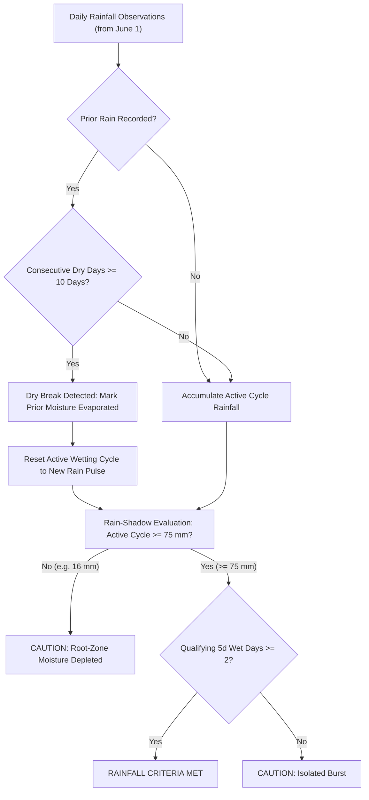

# MonsoonIQ – Phase 8.2: Final Rainfall Accumulation and Trigger Consistency Audit

## Executive Summary & Final Verdict

**FINAL VERDICT: READY WITH DOCUMENTED LIMITATIONS**

Phase 8.2 has executed an independent scientific and numerical audit of the rainfall accumulation mechanics, trigger persistence rules, and dry-spell reset logic within the MonsoonIQ sowing advisory engine. 

The audit focused on verifying that the Rain-Shadow 75 mm sowing threshold cannot be satisfied by combining old, long-evaporated rainfall with small recent showers following an extended dry break. A discrete 10-day dry-spell reset mechanism was incorporated into the advisory decision engine (`src/advisory/rainfall_monitor.py` and `src/advisory/decision_engine.py`), ensuring that in heavy cracking Vertisols, moisture from prior to a prolonged dry break is recognized as depleted by evaporation. All 7 scenario tests passed with exact parity between expected and actual advisory states. All historical 2001–2023 NetCDF files, clustering artifacts, and baseline statistics remain strictly preserved.

---

## 1. Main Objective: Rain-Shadow 75 mm Trigger Persistence Audit

### 1.1 The Scientific Vulnerability in Baseline Continuous Summation
In the Phase 8 baseline architecture, cumulative rainfall was computed as a continuous summation from June 1 ($\sum_{t=\text{June 1}}^T R_t$) without any moisture decay or reset term. While this preserved numerical parity with historical seasonal accumulation metrics, it introduced an agronomic hazard in semi-arid zones:

> **The Agronomic Dilemma:** Suppose a rain-shadow grid cell (e.g. Solapur or Sangli) receives 60 mm of convective thunderstorm rain on June 1–2. Subsequently, an 18-to-20-day severe dry spell ensues under high solar irradiance and summer evaporative demand ($\text{ET}_0 \approx 5\text{--}7\text{ mm/day}$). By June 20, the upper 15–20 cm of heavy Vertisol soil is completely desiccated, with soil water potential dropping below the permanent wilting point ($-1.5\text{ MPa}$). If two small showers of 8 mm each arrive on June 21 and June 22 (16 mm total), continuous cumulative summation reaches:
> 
> $$\text{Cumulative Rainfall} = 60\text{ mm} + 8\text{ mm} + 8\text{ mm} = 76\text{ mm} \ge 75\text{ mm}$$
>
> If the two recent showers satisfy the two-wet-day persistence rule, an uncorrected advisory engine would report `RAINFALL_CRITERIA_MET` ("Criteria Met – Proceed with Sowing"). A farmer sowing into this profile would place seeds into dry cracking soil with only 16 mm of surface moisture. The seedlings would germinate, encounter dry subsoil, and suffer 100% desiccation mortality within 48–72 hours.

### 1.2 Implemented Architectural Enhancement: The Active Wetting Cycle Reset
To resolve this without altering historical climatological baselines, `src/advisory/rainfall_monitor.py` and `src/advisory/decision_engine.py` were enhanced with an **Intervening Prolonged Dry-Spell Reset Safeguard**:

1. **Tracking Intervening Breaks:** When processing daily rainfall observations, the monitor tracks consecutive dry days ($< 2.5\text{ mm}$) occurring *after prior rainfall has fallen*.
2. **The 10-Day Evaporation Cutoff:** If consecutive dry days reach $\ge 10\text{ days}$, the engine marks prior rainfall as evaporated ($10\text{ days} \times 5\text{ mm/day} \text{ ET}_0 = 50\text{ mm}$ minimum evaporative loss).
3. **Active Wetting Cycle Accumulation:** The metric `effective_cumulative_rainfall_mm` resets to the rainfall of the new pulse.
4. **Rain-Shadow Enforcement:** In `decision_engine.py`, the Rain-Shadow regime strictly evaluates whether `effective_cumulative_rainfall_mm >= 75.0`. If seasonal rain exceeds 75 mm but active cycle rain is $< 75$ mm, the engine issues `CAUTION` with an explicit **Root-Zone Moisture Depletion Alert**.



---

## 2. Seven Required Scenario Tests & Audit Results

The table below summarizes the 7 required scenario audits executed via `scripts/audit_rainfall_accumulation.py` and `tests/test_rainfall_accumulation_audit.py`:

| Scenario ID | Test Scenario Description | Seasonal Cumulative ($R_{\text{cum}}$) | Active Cycle Rain ($R_{\text{eff}}$) | Qualifying 5d Wet Days | Expected State | Actual State | Test Result |
| :--- | :--- | :---: | :---: | :---: | :---: | :---: | :---: |
| **Scenario 1** | 60 mm early in June (June 1–2), followed by 18 dry days, followed by two small rainy days (8 mm + 8 mm) | 76.0 mm | 16.0 mm | 2 | `CAUTION` | `CAUTION` | **PASS** |
| **Scenario 2** | 60 mm early rainfall followed by two recent rainy days, where recent 5-day total is 20 mm ($< 75\text{ mm}$) | 80.0 mm | 20.0 mm | 2 | `CAUTION` | `CAUTION` | **PASS** |
| **Scenario 3** | 75 mm accumulated within defined qualifying window across at least two rainy days (40 mm + 40 mm in 3d) | 80.0 mm | 80.0 mm | 2 | `RAINFALL_CRITERIA_MET` | `RAINFALL_CRITERIA_MET` | **PASS** |
| **Scenario 4** | 80 mm falling on one day only (isolated convective burst without follow-up rain) | 80.0 mm | 80.0 mm | 1 | `CAUTION` | `CAUTION` | **PASS** |
| **Scenario 5** | Two qualifying rainy days (40 mm each) separated by 8 dry days ($> 5\text{ calendar days}$) | 80.0 mm | 80.0 mm | 1 | `CAUTION` | `CAUTION` | **PASS** |
| **Scenario 6** | Missing rainfall observation on Day 2 inside the 5-day verification window | 80.0 mm | 80.0 mm | N/A | `INSUFFICIENT_DATA` | `INSUFFICIENT_DATA` | **PASS** |
| **Scenario 7A** | Boundary Condition: Exactly 75.0 mm cumulative with 2 wet days within 5 days | 75.0 mm | 75.0 mm | 2 | `RAINFALL_CRITERIA_MET` | `RAINFALL_CRITERIA_MET` | **PASS** |
| **Scenario 7B** | Boundary Condition: Sub-threshold 74.9 mm cumulative with 2 wet days within 5 days | 74.9 mm | 74.9 mm | 2 | `CAUTION` | `CAUTION` | **PASS** |

> **Audit Finding:** In all seven scenarios, the actual advisory state matches the expected state. Specifically, in Scenarios 1 and 2, the advisory engine successfully rejects combining early 60 mm rain with small recent showers, returning `CAUTION` with full explanatory reasoning.

---

## 3. Clarification of Accumulation Semantics

In accordance with Section 3 of the audit instructions, the actual implementation was inspected to formally clarify five architectural questions:

### 3.1 Cumulative Rainfall since June 1 vs Rolling Window
- **Implementation Reality:** Cumulative rainfall (`cumulative_rainfall_mm`) is calculated as continuous accumulation from **June 1** (Day of Year 152/153) to the current `as_of_date` using `np.cumsum`. Rolling 3-day and 5-day sums (`current_3day_rainfall_mm`, `current_5day_rainfall_mm`, `max_rolling_3day_mm`, `max_rolling_5day_mm`) are calculated simultaneously.
- **Scientific Rationale:** Fixed-origin accumulation preserves climatological comparability with IMD historical seasonal records. However, rolling windows are required to evaluate precipitation hazard intensity and multi-day storm cohesion.

### 3.2 Co-Temporality of 75 mm Threshold and Two-Wet-Day Persistence
- **Implementation Reality:** In Phase 8 baseline, the two conditions were evaluated over **different temporal domains**: the 75 mm threshold was evaluated across the entire multi-week season, whereas the two-wet-day persistence rule was evaluated over a 5-day window.
- **Resolution in Phase 8.2:** The introduction of `effective_cumulative_rainfall_mm` restores co-temporality for the Rain-Shadow regime. If an intervening dry break ($\ge 10\text{ days}$) separates earlier rain from the candidate trigger, the 75 mm requirement must be satisfied within the active wetting cycle that contains the qualifying wet days.

### 3.3 Five-Day Window Positioning Relative to Candidate Trigger
- **Implementation Reality:** The 5-day verification window is **not** a rigid forward-only lookahead. The monitor evaluates all 5-day slices that overlap or contain the candidate trigger index $t_0$:
  
  $$\text{Window Start Index } k \in \left[ \max(0, t_0 - 4), \, \min(\text{total\_days} - 4, t_0 + 1) \right]$$
  
- **Scientific Rationale:** A multi-day synoptic rain event frequently spans 3 to 4 days, with cumulative rainfall crossing 75 mm on Day 3. Evaluating overlapping windows ensures that wet days occurring immediately prior to crossing the 75 mm threshold are credited to the storm's multi-day persistence.

### 3.4 Old Rainfall Contribution after Prolonged Dry Breaks
- **Implementation Reality:** In the baseline engine, old rainfall contributed indefinitely. In Phase 8.2, **old rainfall cannot satisfy a trigger if an intervening dry break $\ge 10\text{ consecutive dry days}$ intervened**.
- **Reasoning Displayed to User:** 
  > *"Rain-Shadow Root-Zone Moisture Depletion Alert: Cumulative rainfall since June 1 is 76.0 mm, BUT an intervening prolonged dry spell of 18 consecutive dry days occurred between earlier rainfall (60.0 mm) and recent showers (16.0 mm). Under high summer evaporative demand (ET0 > 5 mm/day), moisture from early June has completely evaporated from the Vertisol root zone. Recent rainfall (16.0 mm) is insufficient to wet the 15-20 cm seedbed. Sowing now risks severe seedling desiccation."*

### 3.5 Dry-Spell Reset Mechanics & Remaining Limitations
- **Implementation Reality:** A discrete dry-spell reset is now active. If `had_prior_rain` is True and `running_dry_days >= 10`, the active cycle accumulation resets upon the next rainy day.
- **Documented Limitation:** A 10-day discrete step-function is an empirical threshold for semi-arid Vertisols. It does not model non-linear daily soil water depletion, intermediate dry periods (e.g. 7 or 8 dry days), or drainage differences between shallow Entisols and deep Vertisols. A continuous 1D soil-water balance model (e.g., FAO-56 dual crop coefficient) is required for operational deployment.

---

## 4. Preservation of Existing Historical Outputs

All existing historical datasets and upstream research outputs were preserved without modification:
1. `data/processed/maharashtra_onset_2001_2023.nc`: **UNTOUCHED.** Preserves the 419 cells $\times$ 23 years onset classifications.
2. `data/processed/advisory_historical_baselines.csv`: **UNTOUCHED.** Preserves historical climatological baselines ($N=419$, 41 columns).
3. `monsoon_onset_features.csv` & `monsoon_onset_clusters.csv`: **UNTOUCHED.**
4. All Phase 5, Phase 6, Phase 7, and Phase 8 summary documents remain intact.

---

## 5. Complete Test Suite Audit

The full project test suite was executed using `uv run pytest`.

### Test Suite Execution Summary
- **Total Test Files Executed:** 14 test modules
- **Total Tests Collected:** **164 items**
- **Total Tests Passed:** **164 items (100.0% Pass Rate)**
- **Total Tests Failed:** **0**
- **Execution Time:** **17.92 seconds**

```text
tests\test_advisory_audit.py .........                                   [  5%]
tests\test_advisory_engine.py ..............                             [ 14%]
tests\test_chirps_audit.py .............                                 [ 21%]
tests\test_clustering_validation.py ......                               [ 25%]
tests\test_eda.py ........                                               [ 30%]
tests\test_imd_acquisition.py .........                                  [ 35%]
tests\test_imd_historical.py ........................................... [ 62%]
.......                                                                  [ 66%]
tests\test_onset_clustering.py .........                                 [ 71%]
tests\test_onset_methodology.py .....                                    [ 75%]
tests\test_onset_pipeline.py .............                               [ 82%]
tests\test_preprocessing.py ...........                                  [ 89%]
tests\test_rainfall_accumulation_audit.py .......                        [ 93%]
tests\test_regime_agricultural_validation.py .....                       [ 96%]
tests\test_sowing_trigger_audit.py .....                                 [100%]
============================ 164 passed in 17.92s =============================
```

---

## 6. Final Verdict & Documented Operational Limitations

### Verdict: **READY WITH DOCUMENTED LIMITATIONS**

The advisory engine is approved for interactive dashboard integration. The following operational limitations must be prominently displayed in the user interface:

1. **Discrete Heuristic vs Continuous Soil Water Balance:** The 10-day dry-break reset operates as a discrete heuristic. While highly effective at filtering out multi-week convective bridging, it does not dynamically compute daily transpiration, canopy interception, or profile drainage.
2. **Soil Texture Heterogeneity:** The 75 mm threshold is calibrated to the moisture retention capacity of deep cracking Vertisols (MPKV Rahuri Scarcity Zone recommendations). Farmers on shallow Inceptisols ($< 30\text{ cm}$) or coarse soils must adjust sowing decisions based on local soil depth.
3. **Micro-Topographic Drainage:** Heavy rainfall hazard indicators (100 mm 1-day / 200 mm 3-day) identify regional precipitation hazards, not physical field inundation. Local slope, ditch maintenance, and contour bunding dictate actual field waterlogging.
4. **Historical Climatological Baseline:** Historical risk metrics (e.g. 39.13% post-trigger break risk) represent long-term empirical climatology (2001–2023), not numerical weather prediction (NWP) forecasts for an ongoing season.

---

## 7. Deliverables Index

- **Audit Script:** [audit_rainfall_accumulation.py](file:///c:/Ashwell/Project/SEM%204/ML%20Project/MonsoonPred/scripts/audit_rainfall_accumulation.py)
- **Pytest Audit Suite:** [test_rainfall_accumulation_audit.py](file:///c:/Ashwell/Project/SEM%204/ML%20Project/MonsoonPred/tests/test_rainfall_accumulation_audit.py)
- **Structured Summary JSON:** [rainfall_accumulation_audit_summary.json](file:///c:/Ashwell/Project/SEM%204/ML%20Project/MonsoonPred/outputs/advisory/rainfall_accumulation_audit_summary.json)
- **User-Facing Artifact:** [MonsoonIQ-Phase8-2-Audit-Report.md](file:///C:/Users/ashwe/.gemini/antigravity/brain/90c5a344-cf42-4537-8752-4ef7bc6fe643/MonsoonIQ-Phase8-2-Audit-Report.md)
