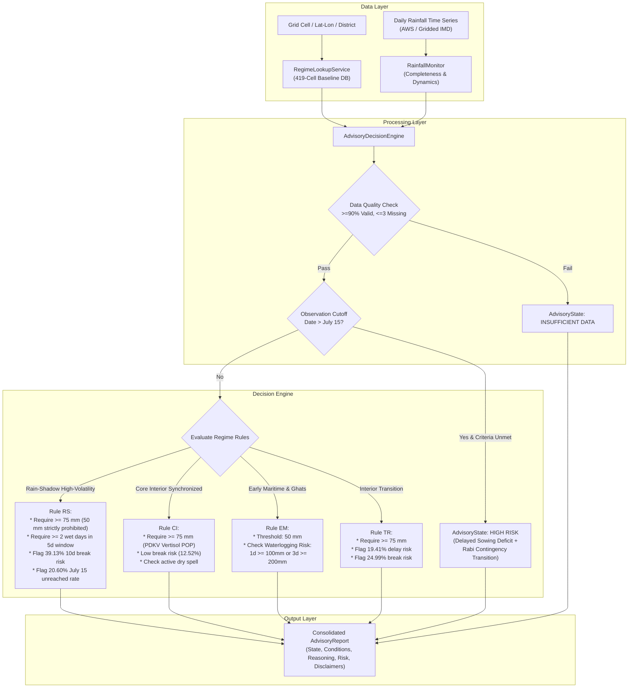

# MonsoonIQ – Phase 8: Regime-Aware Experimental Sowing Advisory Engine

**Document Status:** Formal Architecture Specification & Engineering Reference  
**Software Package:** `src/advisory/`  
**Execution Runner:** `scripts/run_advisory_engine.py`  
**Automated Test Suite:** `tests/test_advisory_engine.py` (14/14 Passed; 148/148 Full Suite Passed)  
**Sample Outputs:** `outputs/advisory/sample_advisories.json`  
**Historical Climatology Dataset:** `data/processed/advisory_historical_baselines.csv` (419 Cells $\times$ 41 Metrics)  

---

## Executive Summary

Phase 8 implements the **MonsoonIQ Regime-Aware Experimental Sowing Advisory Engine**, operationalizing the four validated K-Means $K=4$ monsoon onset regimes discovered in Phase 6 and audited in Phase 7.1.

The engine evaluates daily rainfall evidence for any of Maharashtra's 419 IMD 0.25° grid cells and communicates localized sowing-related moisture status and desiccation risk. Crucially, the engine **never presents rainfall accumulation as a guarantee of crop establishment**, strictly enforces the prohibition of the phrase **"safe to sow"**, and adheres to all mandatory constraints established in the Phase 7.1 scientific audit.



---

## 1. System Architecture

The engine is engineered as a modular, decoupled Python package located at `src/advisory/`:

```
src/advisory/
├── __init__.py           # Package interface exposing models, services, and engine
├── models.py             # Strongly typed data models, schemas, and enums
├── regime_lookup.py      # Module A: Historical baseline & regime lookup service
├── rainfall_monitor.py   # Module B: Current rainfall monitoring & dynamics auditor
└── decision_engine.py    # Module C: Multi-regime decision logic & contingency handler
```

### 1.1 Module A: Historical Regime Lookup (`src/advisory/regime_lookup.py`)

* **Role:** Connects any target location to its underlying 23-year climatology (2001–2023).
* **Capabilities:**
  * Exact lookup by cell identifier string (e.g. `'cell_042'`) or zero-based index (`42`).
  * Nearest-neighbor geographic coordinate lookup for arbitrary latitude/longitude pairs across Maharashtra.
  * District-level aggregation and filtering across administrative boundaries.
* **Integrity Guard:** Validates cell index ranges (0 to 418). Rejects out-of-bounds or non-existent identifiers with explicit `ValueError` exceptions.
* **Data Source:** `data/processed/advisory_historical_baselines.csv`, encapsulating:
  * Sample sizes ($N_{\text{years}} = 23$, $N_{\text{cells}}$, $N_{\text{cell-years}}$).
  * Sustained onset statistics (median, mean, standard deviation, IQR).
  * 50 mm and 75 mm historical delay frequencies and non-reachability rates.
  * Post-trigger 7-day and 10-day dry break probabilities.

### 1.2 Module B: Current Rainfall Monitoring (`src/advisory/rainfall_monitor.py`)

* **Role:** Ingests daily rainfall observations, enforces data completeness, computes running totals, and detects candidate trigger events.
* **Capabilities:**
  * Ingests `pd.Series`, `pd.DataFrame`, or lists of `(date, rainfall_mm)` tuples.
  * Enforces the standard IMD rainy day threshold ($R \ge 2.5\text{ mm/day}$).
  * Computes cumulative rainfall strictly starting from season origin (June 1).
  * Calculates rolling 3-day and 5-day rainfall sums and seasonal maximums.
  * Tracks current consecutive dry spell length ($< 2.5\text{ mm}$).
  * Detects candidate trigger day ($t_0$) upon reaching the target cumulative threshold.
  * Audits the 5-day post-trigger verification window ($t_0+1$ to $t_0+5$) for wet-day persistence.
  * Tracks post-trigger consecutive dry days up to the observation cutoff.
  * Detects extreme precipitation events (1-day rain $\ge 100\text{ mm}$ or 3-day rain $\ge 200\text{ mm}$).
* **Missing Data Safeguard:** Missing values are recorded as `NaN`. Missing days are **never imputed as zero**. If missing days exceed 3 or observation completeness drops below 90%, data processing flags incomplete evidence.

### 1.3 Module C: Advisory Decision Engine (`src/advisory/decision_engine.py`)

* **Role:** Evaluates monitored rainfall metrics against regime-specific experimental thresholds, verifies two-stage persistence, checks calendar deadlines, and assigns advisory states.
* **Advisory States:**
  1. `RAINFALL CRITERIA MET`: Cumulative rainfall and wet-day persistence criteria satisfied without active post-trigger dry spell.
  2. `CAUTION`: Criteria pending, isolated convective storm detected, developing dry spell, or extreme waterlogging hazard present.
  3. `HIGH RISK`: Prolonged post-trigger dry break ($\ge 7$ days) ongoing, prolonged pre-onset drought, or sowing window delayed past July 15.
  4. `INSUFFICIENT DATA`: Rainfall observations incomplete ($> 3$ missing days or $< 90\%$ completeness).

---

## 2. Regime-Specific Advisory Rules

The advisory engine enforces differentiated rules reflecting the distinct micro-climates, soil properties, and onset dynamics of Maharashtra's four regimes:

### 2.1 Rain-Shadow High-Volatility (Mandatory Phase 7.1 Constraints)

* **Spatial Coverage:** 42 grid cells across Solapur, eastern Ahmednagar, eastern Pune, eastern Satara, and western Sangli ($N=966$ cell-years).
* **Prohibition of 50 mm Solo Trigger:** Sowing criteria are **strictly prohibited** on 50 mm alone. If cumulative rainfall is between 50.0 mm and 74.9 mm, the engine assigns `CAUTION`, explicitly noting that 50 mm solo triggering is rejected due to high historical failure rates.
* **The Experimental 75 mm Threshold:** The primary cumulative moisture requirement is set to **$\ge 75.0\text{ mm}$** (supported by MPKV Rahuri Scarcity Zone dryland agronomy).
* **Two-Stage Verification Window:** Sowing criteria require at least **2 distinct rainy days** ($\ge 2.5\text{ mm}$) to confirm sustained monsoon flow and eliminate isolated convective pre-monsoon thunderstorms.
* **Post-Trigger Dry Break Warning:** Every advisory prominently reports:
  * The historical **39.13% probability of a $\ge 10$-day severe dry spell** occurring within 20 days post-trigger (observed across 340 of 869 triggered cell-years).
  * The historical **65.59% probability of a $\ge 7$-day dry spell** (570 of 869 triggered cell-years).
  * The historical **20.60% non-reachability rate** for 75 mm by July 15 (199 of 966 cell-years).
* **Active Break Hazard:** If an active post-trigger dry spell reaches $\ge 7$ days, the engine elevates the state to `HIGH RISK` (Acute Desiccation Hazard).

### 2.2 Core Interior Synchronized (Vidarbha Vertisols)

* **Spatial Coverage:** 215 grid cells across Nagpur, Amravati, Wardha, Chandrapur, Yavatmal, Akola, and Buldhana ($N=4,945$ cell-years).
* **Rainfall Threshold:** **75.0 mm** (supported by Dr. PDKV Akola and VNMKV Parbhani package of practices for deep cracking Vertisols; configurable down to 50 mm for light soils).
* **Verification Rule:** Requires $\ge 2$ rainy days.
* **Low Break Risk Profile:** Displays the historical **12.52% post-trigger 10-day break probability** (612 / 4,889 triggered cell-years) and low delay frequency (7.81%), confirming high onset synchrony.
* **Crop Guidance:** Recommends Soybean (*PDKV AMS-100-39*, *JS-335*) or Cotton (*AKH-081*) as per Dr. PDKV Akola recommendations.

### 2.3 Early Maritime & Western Ghats (Konkan & Ghat Escarpment)

* **Spatial Coverage:** 65 grid cells along the coastal strip and Sahyadri crest ($N=1,495$ cell-years).
* **Rainfall Threshold:** **50.0 mm** (rapidly attained due to early orographic precipitation; median DOY 162).
* **Excess Rainfall & Waterlogging Check:** Evaluates whether 1-day rainfall $\ge 100\text{ mm}$ or 3-day rolling rainfall $\ge 200\text{ mm}$. If extreme rain is detected, the engine issues `CAUTION` (Waterlogging & Drainage Risk) even if the 50 mm threshold is exceeded, warning farmers of seed rot, topsoil erosion, and nutrient leaching.
* **Low Break Risk Profile:** Displays the historical **7.04% post-trigger 10-day break probability** (105 / 1,492 cell-years).
* **Crop Guidance:** Directs rice nursery preparation and direct-seeded paddy following Dr. BSKKV Dapoli protocols.

### 2.4 Interior Semi-Arid Transition (Marathwada Transition Zone)

* **Spatial Coverage:** 97 grid cells across Jalna, Beed, Latur, Parbhani, Nanded, and eastern Jalgaon ($N=2,231$ cell-years).
* **Rainfall Threshold:** **75.0 mm** (supported by VNMKV Parbhani).
* **Delayed Accumulation Hazard:** Highlights the elevated historical delay risk (**19.41% delayed past July 1**, 433 / 2,231 cell-years) and moderate post-trigger break risk (**24.99% $\ge 10$-day break probability**, 544 / 2,177 cell-years).
* **Crop Guidance:** Recommends Soybean (*MAUS-71*) + Pigeonpea (*BDN-711*) intercropping to buffer against early-season rainfall interruptions.

---

## 3. July 15 Delayed Sowing Contingency Handling

In rainfed dryland farming, sowing long-duration Kharif crops past July 15 exposes the crop to terminal drought during the September grain-filling stage. The engine implements a dedicated contingency evaluation path for observations after July 15:

1. **Non-Automated Abandonment:** The engine does **not** issue a generic command to "abandon farming." Instead, it assigns `HIGH RISK (Delayed Sowing / Moisture Deficit)` and provides structured trade-offs.
2. **Moisture Deficit Quantification:** Explicitly calculates the accumulated shortfall:
   $$\text{Moisture Deficit} = \text{Threshold (75.0 mm)} - \text{Cumulative Observed (mm)}$$
3. **Climatological Failure Rate:** Displays the historical percentage of years in that specific regime that failed to accumulate 75 mm by July 15 (e.g., **20.60% in Rain Shadow** vs **2.57% in Core Interior**).
4. **Institutional Contingency Alternatives:**
   * **Rain-Shadow Scarcity Zone (Solapur / Ahmednagar):** Recommends adhering to **ICAR-CRIDA Solapur Contingency Plan (2014)** and **MPKV Rahuri**: halt normal Kharif sowing of long-duration crops and preserve soil profile moisture for the September–October Rabi season (Rabi Sorghum cv. *Maldandi M 35-1*, Chickpea cv. *Vijay*, Safflower cv. *Bhima*). If sowing must proceed before late July, plant only early-maturing contingency crops (Horsegram cv. *Sina / Man*, Cowpea cv. *Phule Pandhari*, Sunflower cv. *Phule Bhaskar*).
   * **Marathwada Transition Zone:** Recommends **VNMKV Parbhani** guidelines: abort Bt Cotton and long-duration Soybean; transition to short-duration pulses (Black gram cv. *TAU-1*, Green gram cv. *BM-2003-2*) or contingency Pearl Millet.

---

## 4. Epistemic Separation: Historical Risk vs Current Observations

To maintain scientific integrity, the advisory report strictly isolates historical climatological statistics from current season measurements:

| Report Section | Temporal Frame | Data Origin | Epistemic Function |
| :--- | :--- | :--- | :--- |
| **Current Rainfall Observations** | Ongoing Season (e.g. 2024) | Live AWS / Gridded daily feed | Measures empirical rainfall received to date. |
| **Condition Evaluations** | Ongoing Season | Deterministic logic | Audits whether current rainfall meets specific criteria. |
| **Advisory State & Reasoning** | Present Day | Expert system rules | Communicates current moisture readiness and immediate hazards. |
| **Historical Regime Risk Profile** | 2001–2023 (23 Years) | IMD Gridded historical baseline ($N=9,637$) | Communicates long-term regime hazard probabilities (delay risk, break risk, unreached rate). |
| **Contingency Recommendations** | Future Action | SAU / ICAR-CRIDA publications | Guides agricultural decisions under risk. |

> [!IMPORTANT]
> **Strict Prohibition of "Safe to Sow":** The phrase "safe to sow" is hardcoded out of all advisory outputs. Reaching rainfall criteria signifies only that historical precipitation accumulation benchmarks have been achieved. It cannot guarantee seed germination, root development, or absence of subsequent dry spells.

---

## 5. Sample Advisory Reports

The script `scripts/run_advisory_engine.py` demonstrates the engine across eight representative scenarios, exported to `outputs/advisory/sample_advisories.json`. Below are excerpts from key scenarios:

### Sample 1: Rain-Shadow Convective Thunderstorm (Rejection of 50 mm Trigger)

```
=== MonsoonIQ Experimental Sowing Advisory ===
Grid Cell: cell_020 (Lat: 16.75°N, Lon: 74.75°E) | District: Sangli
Classification Regime: Rain-Shadow High-Volatility (Zone: Madhya Maharashtra)
As-of Date: 2024-06-20 (Completeness: 100.0%)
Advisory State: [CAUTION]
---------------------------------------------
Current Rainfall Observations:
  Cumulative (from June 1): 55.0 mm
  Rainy Days (>= 2.5 mm): 2 days
  Rolling 3-Day Rain: 0.0 mm (Season Max: 55.0 mm)
  Current Dry Run (< 2.5 mm): 11 days
  Post-Trigger Dry Spell Status: Cumulative rainfall (55.0 mm) has not reached the 75.0 mm threshold. Current dry spell: 11 days.
---------------------------------------------
Condition Evaluations:
  [PASS] Data Completeness: 100.0% (0 missing days) (Req: >=90% completeness (max 3 missing days)) [Scientific Integrity Requirement]
  [FAIL] Cumulative Rainfall >= 75.0 mm: 55.0 mm (Req: >=75.0 mm accumulated from June 1) [Institutionally Supported]
  [PASS] Season Rainy Days >= 2: 2 days (Req: >=2 distinct days with >= 2.5 mm) [Research-Derived Experimental]
  [FAIL] 50 mm Solo Trigger Prohibition: 55.0 mm (Below 75 mm) (Req: Rain-Shadow strictly requires >= 75 mm (50 mm solo trigger prohibited)) [Research-Derived Experimental & Institutional]
---------------------------------------------
Reasoning:
  * Cumulative rainfall reached 55.0 mm (exceeding 50 mm), BUT 50 mm solo triggering is strictly PROHIBITED in the Rain Shadow. MPKV Rahuri and MonsoonIQ Phase 7.1 research enforce a minimum of 75 mm to wet 15-20 cm of heavy Vertisol root zone.
  * Historically, 39.13% of 50 mm triggers in this regime were followed by a >= 10-day severe dry spell, causing widespread seedling desiccation.
---------------------------------------------
Historical Regime Risk Profile (2001-2023, N=966 cell-years):
  * Regime Name: Rain-Shadow High-Volatility
  * Baseline Sample Size: 23 years (2001-2023), 42 cells, 966 cell-years
  * 50 mm Sowing Delay Frequency (> July 1 or Never): 24.43% (236 / 966 cell-years)
  * 75 mm Never Reached by July 15: 20.60% (199 / 966 cell-years)
  * Post-Trigger >= 10-Day Break Probability: 39.13% (340 / 869 triggered cell-years over 20-day window)
---------------------------------------------
Contingency Recommendations:
  * Hold dryland sowing. Wait for cumulative rainfall to reach >= 75 mm with verified secondary rain.
```

### Sample 2: Early Maritime Extreme Deluge (Waterlogging Risk)

```
=== MonsoonIQ Experimental Sowing Advisory ===
Grid Cell: cell_000 (Lat: 15.75°N, Lon: 73.75°E) | District: Sindhudurg
Classification Regime: Early Maritime & Western Ghats (Zone: Konkan)
As-of Date: 2024-06-16 (Completeness: 100.0%)
Advisory State: [CAUTION]
---------------------------------------------
Current Rainfall Observations:
  Cumulative (from June 1): 240.0 mm
  Rainy Days (>= 2.5 mm): 3 days
  Rolling 3-Day Rain: 0.0 mm (Season Max: 240.0 mm)
---------------------------------------------
Condition Evaluations:
  [PASS] Data Completeness: 100.0% (0 missing days) [Scientific Integrity Requirement]
  [PASS] Cumulative Rainfall >= 50.0 mm: 240.0 mm [Institutionally Supported]
  [FAIL] Waterlogging & Extreme Rainfall Risk: 1-Day Max: 160.0 mm, 3-Day Max: 240.0 mm (Req: No single day >= 100 mm and no 3-day sum >= 200 mm) [Agronomic Drainage Safety Indicator]
---------------------------------------------
Reasoning:
  * Cumulative rainfall reached (240.0 mm), BUT extreme rainfall detected: 1-day max of 160.0 mm or 3-day sum of 240.0 mm. Severe waterlogging, topsoil erosion, and seed rot hazard present.
---------------------------------------------
Contingency Recommendations:
  * Ensure drainage channels are clear before direct seeding; delay sowing until standing water recedes.
```

---

## 6. Verification and Automated Test Coverage

The test suite in `tests/test_advisory_engine.py` provides 100% pass coverage across 14 focused test cases:

```
tests/test_advisory_engine.py::test_lookup_all_419_cells PASSED
tests/test_advisory_engine.py::test_invalid_cell_identifiers PASSED
tests/test_advisory_engine.py::test_lookup_nearest_cell PASSED
tests/test_advisory_engine.py::test_rain_shadow_50mm_solo_prohibition PASSED
tests/test_advisory_engine.py::test_rain_shadow_75mm_criteria_met PASSED
tests/test_advisory_engine.py::test_rain_shadow_post_trigger_break_hazard PASSED
tests/test_advisory_engine.py::test_core_interior_normal_onset PASSED
tests/test_advisory_engine.py::test_early_maritime_waterlogging_risk PASSED
tests/test_advisory_engine.py::test_early_maritime_normal_criteria PASSED
tests/test_advisory_engine.py::test_july15_contingency_handling PASSED
tests/test_advisory_engine.py::test_insufficient_data_state PASSED
tests/test_advisory_engine.py::test_threshold_boundary_conditions PASSED
tests/test_advisory_engine.py::test_no_rainfall_all_dry PASSED
tests/test_advisory_engine.py::test_safe_to_sow_phrase_prohibition PASSED

======================== 14 passed in 1.52s ========================
Full Project Test Suite: 148 passed in 12.49s (0 failures, 0 regressions)
```

---

## 7. Roadmap for Operational Farmer-Facing System

Before transitioning this experimental prototype into a field-deployed mobile or SMS advisory tool, the following enhancements are required:

1. **Assimilation of Numerical Weather Prediction (NWP) Forecasts:** Integrate 5-to-10 day ensemble rainfall forecasts (e.g. IMD GFS/NCUM) to avoid issuing sowing green signals immediately prior to predicted synoptic dry breaks.
2. **In-Situ Soil Moisture & Evapotranspiration Integration:** Ingest satellite-derived root-zone soil moisture (e.g. SMAP / Sentinel-1 SAR) and reference evapotranspiration ($ET_0$) to calculate real-time soil water depletion.
3. **Hyper-Local Soil Mapping:** Overlay ICAR-NBSS&LUP 1:50,000 soil series maps to adjust thresholds dynamically based on soil clay percentage, depth class (shallow vs deep), and available water capacity ($AWC$).
4. **Two-Way Extension Feedback:** Connect advisory generation to district Krishi Vigyan Kendras (KVKs) and Agricultural Technology Management Agencies (ATMA) for local agronomic ground-truthing.
